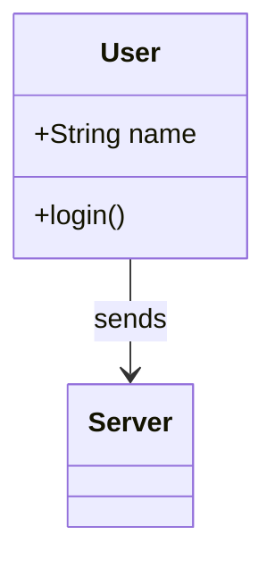
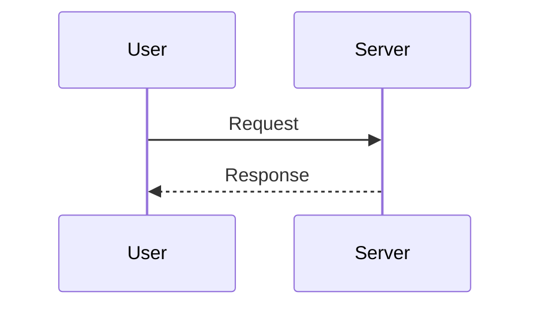

# Mermaid Diagram Studio (오프라인 다이어그램 편집기)

제공된 `diagram_editor_spec` 설계 문서를 기준으로 제작한 **Python / PyQt6 데스크톱 편집기 소스 프로젝트**입니다. Windows와 macOS를 대상으로 하며 실행 중 원격 서버, CDN, 텔레메트리, 자동 업데이트를 요청하지 않습니다.

> **구현 단계: 기능 프로토타입 0.1.0.** 클래스/시퀀스의 제한된 Mermaid 문법을 자체 Python 파서로 처리합니다. 설계 문서에 명시된 **공식 Mermaid JS 런타임 통합은 아직 구현되지 않았습니다.** GUI는 PyQt6 설치 환경에서 실행하도록 작성되었으나 현재 제작 환경에는 PyQt6가 없어 실제 GUI 동작 검증과 OS별 패키징을 완료하지 못했습니다. 지원 범위를 넘어선 코드는 마지막 정상 다이어그램을 유지하고 오류를 표시합니다.

## 1. 설치 및 실행

**Windows 권장: BAT 더블클릭 실행** (명령어를 직접 입력하지 않아도 됩니다.)

1. 전체 프로젝트 ZIP을 내려받았다면 **ZIP을 먼저 전체 압축 해제**합니다. 압축파일 내부에서 BAT를 직접 실행하지 마세요.
2. 압축을 푼 `diagram-editor` 폴더에서 **`InstallAndStart.bat`**을 더블클릭합니다.
3. Python이 없으면 `winget`을 통한 **Python 3.12 설치 여부를 확인**하고, 동의한 경우 자동 설치합니다. 이어 `.venv` 가상환경 및 필요한 패키지를 설치하고 프로그램을 실행합니다.
4. **이후부터는 `Start.bat`**을 더블클릭하면 됩니다. 이미 설치된 경우 인터넷 연결은 필요하지 않습니다.

| BAT 파일 | 역할 |
|---|---|
| `InstallAndStart.bat` | 최초 설치 또는 업데이트 후 프로그램 바로 실행 |
| `Start.bat` | 프로그램 실행. 설치가 안 된 환경이면 자동으로 설치 |
| `Install.bat` | 가상환경 생성, 프로젝트 의존성 설치 또는 업데이트만 수행 |
| `RunTests.bat` | 테스트 의존성 설치 후 단위/통합 테스트 실행 |

- 모든 패키지는 해당 프로젝트 폴더의 **`.venv` 가상환경**에 설치되며 시스템 Python 패키지를 변경하지 않습니다.
- BAT는 별도 PowerShell 스크립트(`scripts/windows/launcher.ps1`)를 호출합니다. `-ExecutionPolicy Bypass`는 **해당 실행 프로세스에만 적용**되며 시스템 보안 정책을 영구 변경하지 않습니다.
- 시스템에 Python **3.11~3.14**가 없고 `winget`도 없다면 Python 3.12를 [Python 공식 사이트](https://www.python.org/downloads/windows/)에서 먼저 설치하세요. `winget` 설치를 거부해도 정상적으로 종료합니다.
- 첫 설치 및 패키지 업데이트는 **인터넷 연결이 필요**합니다. 이미 설치했다면 `Start.bat`은 인터넷 없이도 실행됩니다.
- 회사 PC의 실행 정책, 패키지 관리자, 방화벽 제한이 있다면 IT 정책을 따르세요. 프로그램이 실행되지 않으면 오류 창이 아닌 콘솔에 메시지를 남기고 일시정지합니다.
- Windows용 BAT/PowerShell 실제 실행은 이 제작 환경에서 테스트하지 못했으며, 설치 환경에 따라 Python 설치 또는 관리자 권한이 추가로 필요할 수 있습니다.

**수동 설치** (BAT 대신 직접 실행할 때)

Python **3.11~3.14** 권장 (Windows 자동 설치 버전: **3.12**). 설치 시 인터넷이 필요한 것은 의존성을 내려받는 **개발·설치 단계**뿐이며, 의존성이 설치된 후 앱 구동과 편집에는 인터넷이 필요하지 않습니다. 완전히 오프라인에서 설치하려면 PyQt6 wheel을 미리 받아 로컬 환경에서 설치하세요.

**Windows PowerShell**

```powershell
cd diagram-editor
py -3.12 -m venv .venv
.\.venv\Scripts\python.exe -m pip install -e ".[test]"
.\.venv\Scripts\python.exe -m diagram_editor.main
```

**macOS / Linux 개발 환경**

```bash
cd diagram-editor
python3 -m venv .venv
source .venv/bin/activate
python -m pip install -e '.[test]'
diagram-editor
```

대체 실행 방법: `python -m diagram_editor.main` (패키지 설치 후). PyQt6는 파이썬에 기본 포함되지 않습니다.

## 2. 기능 사용법

앱 시작 시 샘플 클래스 다이어그램이 열립니다. 상단 메뉴에서 **새 시퀀스**, **열기**, **정식 저장**, **내보내기**, **복구 파일 열기**를 선택할 수 있습니다. 좌측에 Mermaid 원문을 입력하면 **350ms 후 자동 검증**을 시작합니다. 문법이 잘못되면 원문은 보존하고 우측에는 마지막 정상 그림이 남습니다. 이 상태에서는 드래그·삭제·붙여넣기가 차단됩니다.

우측 캔버스에서 클래스를 드래그하면 위치만 변경되며 Mermaid 원문에는 좌표를 쓰지 않습니다. 시퀀스 참가자는 **가로 방향 위치만** 저장합니다. 객체를 선택해 복사/붙여넣기/삭제할 수 있고, `Ctrl/Cmd+Z` 및 `Ctrl/Cmd+Shift+Z`를 통해 문서별 통합 이력을 적용합니다. 코드를 직접 선택해 복사/붙여넣을 때는 일반 텍스트 작업으로 처리합니다.

상단 **객체 추가** 또는 캔버스 우클릭으로 클래스/참가자를 추가할 수 있습니다. 캔버스에서 여러 항목을 선택하려면 빈 곳에서 드래그합니다. `Ctrl+마우스 휠` 또는 **보기** 메뉴로 확대·축소할 수 있습니다.

정식 저장 파일의 기본 확장자는 `.dgmzip`입니다. **정식 ZIP은 수동 저장만 변경**하며, **복구 ZIP은 마지막 편집 이후 1초** 동안 추가 변경이 없으면 앱 전용 디렉터리에 별도로 기록됩니다. 오류 원문, 주석 및 공백만 수정한 경우도 저장합니다. PNG/JPEG는 1~4배 실제 픽셀 배율 및 여백·배경색을 지원합니다.

## 3. 현재 지원 Mermaid 문법

**클래스 (`classDiagram`, `classDiagram-v2`)**



- `class ID`, `class ID { ... }`, `ID : member`, `class ID["label"]`
- `--`, `-->`, `<--`, `<-->`, `..`, `..>`, `<..`, `<|--`, `--|>`, `o--`, `*--` 및 일부 역방향 관계
- `%%` 줄 주석 및 공백 보존

**시퀀스 (`sequenceDiagram`)**



- `participant`, `actor`, `participant ID as Name`
- `->`, `->>`, `-->`, `-->>`, `-x`, `--x`, `-)`, `--)`
- 기본 `Note left/right of/over`, `activate`, `deactivate`, `loop`, `alt`, `opt`, `par`, `critical`, `break`, `rect`, `box`, `else`, `and`, `option`, `end`, `autonumber`는 구조적으로 인식하며 **일부 장식·활성화의 시각적 표현은 제한**됩니다.
- 참가자 이동(가로만), 메시지 선택·삭제·복사. **메시지 드래그 재정렬 불가**.

위에 없는 문법, Mermaid의 전체 별칭·스타일·클릭 이벤트·복합 타입·중첩 주석을 보장하지 않습니다. GUI가 안전하게 패치할 수 없는 작업은 거부할 수 있습니다. Mermaid 공식 엔진이 아니므로 Mermaid 최신 버전 문법과 완전히 같다고 가정하지 마세요.

## 4. 테스트

```bash
python -m pip install -e '.[test]'
python -m pytest -q
```

Qt 실제 GUI 스모크 테스트는 PyQt6 및 화면 서버/오프스크린 Qt 플러그인이 준비된 환경에서 별도 실행해야 합니다. 자동 테스트는 `tests/unit`, `tests/integration`에 있습니다.

## 5. 빌드·배포

- Windows: `packaging/windows/build.ps1` (Windows에서 실행)
- macOS: `packaging/macos/build.sh` (macOS에서 실행)

이 스크립트는 OS별 PyInstaller 빌드 **예제**이며, 여기서 실행·검증된 설치 파일은 아닙니다. 실제 릴리스 전 양쪽 운영체제에서 PyQt6 라이선스, 바이너리 동작, 앱 서명·공증, 글꼴 및 이미지 Export를 확인해야 합니다.

## 6. 주요 디렉터리

| 디렉터리 | 내용 |
|---|---|
| `src/diagram_editor/core/` | Qt 비의존 문서 모델 및 Port 계약 |
| `src/diagram_editor/application/` | 세션, Revision, 이력, 동기화 정책 |
| `src/diagram_editor/modules/mermaid/` | 제한된 문법 파서 및 최소 원문 패치 |
| `src/diagram_editor/modules/persistence/` | ZIP 코덱, 정식·복구 Repository |
| `src/diagram_editor/platform/` | 종료 취소 가능한 파일 저장 스레드 |
| `src/diagram_editor/presentation/pyqt/` | 메뉴, 코드 입력, QGraphicsScene 객체 캔버스 |
| `docs/specification/` | 제공된 설계 문서 원본 사본 |
| `docs/IMPLEMENTATION_DECISIONS.md` | **임의 결정한 설정·협의 필요사항** |
| `docs/IMPLEMENTATION_STATUS.md` | 구현 현황 및 미구현 범위 |

**사용 전 확인:** 제품 정책을 사용자와 협의하여 바꾸려면 `docs/IMPLEMENTATION_DECISIONS.md`의 기본값을 변경하고 테스트하세요.
